<p align="center">
  
</p>

```bash
leinx2@github:~$ whoami
leinx2 — student developer, backend & automation

leinx2@github:~$ cat stack.txt
[ OK ] Java + Spring Boot
[ OK ] Clean / Onion Architecture
[ OK ] Python automation scripts

leinx2@github:~$ ls projects/
letterbattle/   transcript-extractor/

leinx2@github:~$ ./contributions --play
```

<p align="center">
  
</p>

```bash
leinx2@github:~$ _
```
